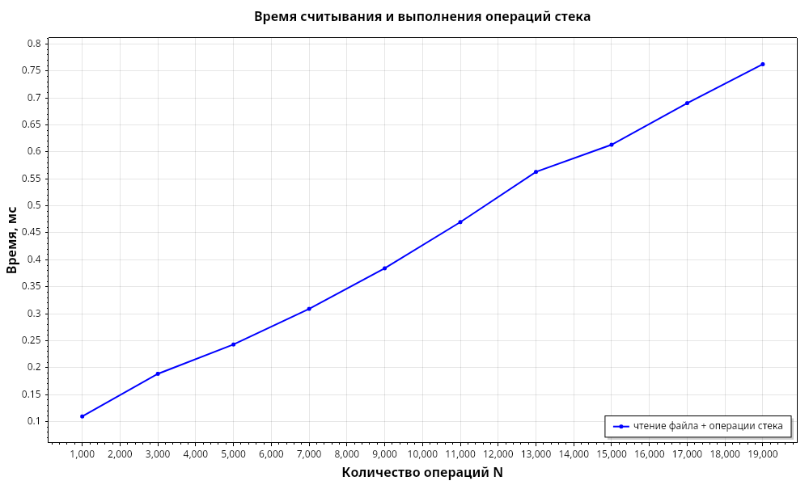
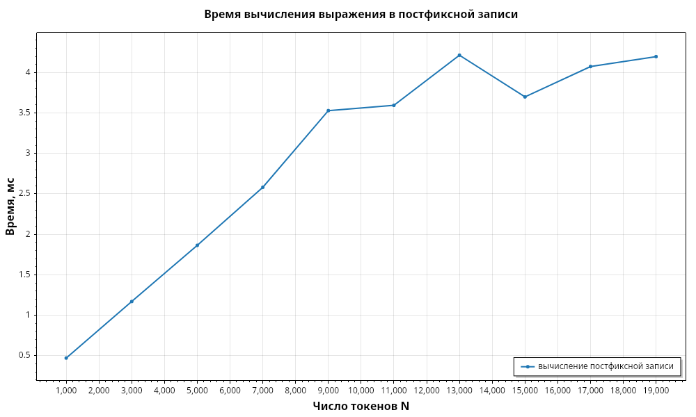
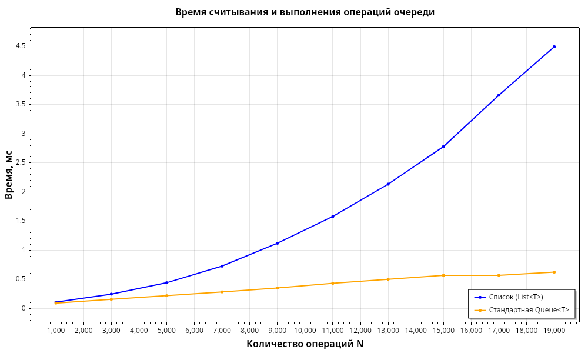

<!--
Сборка:
pandoc lab3.md -o lab3.pdf \
  --pdf-engine=xelatex \
  -H header.tex \
  -B titlepage.tex \
  -V lang=ru-RU \
  -V mainfont="Liberation Serif" \
  -V sansfont="Liberation Sans" \
  -V monofont="Liberation Mono" \
  -V fontsize=12pt

Нумерация разделов уже расставлена в заголовках, поэтому --number-sections использовать не нужно.
Изображения в reports/images.
-->


# 1 Описание архитектуры приложения

## 1.1 Общая структура

Приложение `AlgosLabs` представляет собой настольное приложение на платформе .NET 10 с графическим интерфейсом Avalonia. Решение разделено на два проекта:

- `Algorithms` — библиотека классов с контрактами и реализациями алгоритмов и структур данных, не зависящая от пользовательского интерфейса;
- `AlgosLabs` — приложение Avalonia, содержащее представления, модели представления, сервисы приложения и инфраструктуру доступа к данным.

Такое разделение позволяет использовать структуры данных и алгоритмы независимо от UI и упрощает их проверку. Взаимодействие между слоями организовано по схеме MVVM: представления привязываются к моделям представления, а вычисления выносятся в отдельные сервисы и библиотеку алгоритмов. Представления разделов создаются один раз в `MainViewModel.BuildLabs()` и кэшируются, поэтому при переключении между разделами их состояние сохраняется.

Основные компоненты приложения приведены в таблице 1.

| Компонент | Назначение |
|---|---|
| `MainWindow`, `Sections` | Главное окно, верхняя навигация по лабораторным работам и нижняя навигация по разделам |
| `MainViewModel` | Состояние навигации и сборка списка лабораторных работ и разделов |
| `ChartWindow` | Окно графика на базе ScottPlot |
| `UniversalBenchmarkService` | Общий сервис замера алгоритмов и работы с кэшем |
| `AppDbContext` | Контекст Entity Framework Core для SQLite |
| `Algorithms.Lab?.*` | Алгоритмы и структуры данных соответствующей лабораторной работы |

\tablecaption{Основные компоненты приложения}

## 1.2 Компоненты третьей лабораторной работы

Третья лабораторная работа посвящена динамическим структурам данных: стеку, очереди, связному списку, а также примерам применения списка, стека, очереди и дерева. Все структуры реализованы самостоятельно, без использования стандартных `Stack<T>`, `LinkedList<T>` и `Queue<T>` там, где этого требует задание. Стандартная `Queue<T>` применяется только как эталон для сравнения.

Новые компоненты приведены в таблице 2.

| Компонент | Назначение |
|---|---|
| `LinkedStack<T>` | Стек на собственном односвязном списке: `Push`, `Pop`, `Top`, `IsEmpty`, `Print` |
| `StackCommandProcessor` | Разбор и выполнение команд стека из файла, журнал операций |
| `PostfixEvaluator` | Вычисление выражения в обратной польской записи на собственном стеке |
| `StackBenchmarkService` | Замеры выполнения команд стека и вычисления постфиксных выражений |
| `IQueue<T>`, `ListQueue<T>` | Интерфейс очереди и реализация на `List<T>` с удалением из начала |
| `StandardQueue<T>` | Обёртка над стандартной `Queue<T>` для сравнения |
| `QueueCommandProcessor` | Разбор и выполнение команд очереди из файла |
| `QueueBenchmarkService` | Замеры очередей разной длины и сравнение наборов разного состава |
| `LinkedListMergeSort` | Пример применения списка: сортировка слиянием связного списка |
| `BreadthFirstSearch` | Пример применения очереди: обход графа в ширину |
| `Trie` | Пример применения дерева: префиксное дерево и автодополнение |
| `ListNode<T>`, `SinglyLinkedList<T>` | Узел и собственный односвязный список |
| `LinkedListAlgorithms` | Двенадцать функций обработки связного списка |
| `StackViewModel`, `QueueViewModel`, `DynamicStructuresViewModel`, `LinkedListViewModel` | Модели представления четырёх разделов |
| `StackSectionView`, `QueueSectionView`, `DynamicStructuresSectionView`, `LinkedListSectionView` | Представления разделов |

\tablecaption{Компоненты третьей лабораторной работы}

Дополнительно в проект добавлены файлы с примерами входных данных: `input.txt`, `postfix.txt` и `lists.txt`. Они копируются рядом с исполняемым файлом при сборке.

## 1.3 Взаимодействие компонентов

При запуске приложение создаёт главное окно и модель представления `MainViewModel`. В конструкторе модели представления вызывается метод `BuildLabs()`, который формирует список лабораторных работ. Для третьей лабораторной работы создаются четыре модели представления и четыре представления разделов:

1. «Стек» — `StackViewModel` и `StackSectionView`;
2. «Очередь» — `QueueViewModel` и `QueueSectionView`;
3. «Динамические структуры» — `DynamicStructuresViewModel` и `DynamicStructuresSectionView`;
4. «Связный список» — `LinkedListViewModel` и `LinkedListSectionView`.

Модели представления не содержат реализаций структур данных. Они читают входные файлы, передают данные в классы библиотеки `Algorithms`, форматируют журнал операций и запускают замеры в фоновом потоке через `Task.Run`, чтобы интерфейс не блокировался.

Работа со стеком устроена следующим образом:

1. `StackViewModel.RunStackOperationsAsync` читает `input.txt` и вызывает `StackCommandProcessor.Execute`.
2. Процессор разбирает команды и выполняет их над экземпляром `LinkedStack<string>`.
3. `StackCommandProcessor.FormatLog` формирует текст журнала, который отображается в разделе.
4. `StackViewModel.EvaluatePostfixAsync` читает `postfix.txt` и вызывает `PostfixEvaluator.Evaluate`; результат и пошаговый разбор показываются на экране.
5. Команды `RunStackBenchmarkAsync` и `RunPostfixBenchmarkAsync` вызывают соответствующие методы `StackBenchmarkService` и открывают `ChartWindow` с графиком.

Для очереди используется аналогичная схема, но `QueueCommandProcessor.Execute` принимает конкретную реализацию `IQueue<string>`. Это позволяет выполнить один и тот же набор команд как списковой очередью, так и стандартной `Queue<T>` и сравнить результаты и время. Команда `RunCompositionComparisonAsync` дополнительно сравнивает два набора одинаковой длины, но разного состава: «глубокий» набор поддерживает большую глубину очереди, «мелкий» — почти всегда держит очередь пустой.

Раздел «Динамические структуры» содержит четыре независимые вкладки. Каждая вкладка вызывает свой класс библиотеки:

- сортировка слиянием — `LinkedListMergeSort.Sort`;
- вычисление RPN — `PostfixEvaluator.Evaluate`;
- обход графа — `BreadthFirstSearch.Run`;
- автодополнение — `Trie.Insert`, `Trie.CountWithPrefix` и `Trie.Complete`.

Раздел «Связный список» работает с собственным списком `SinglyLinkedList<int>`. При нажатии «Выполнить» модель представления заново строит список из содержимого полей ввода, вызывает выбранную функцию `LinkedListAlgorithms` и синхронизирует поля с результатом, поэтому следующая операция продолжает работу с уже изменённым списком.

В отличие от второй лабораторной работы, замеры третьей лабораторной работы не записываются в SQLite и не используют общий кэш. Они выполняются по запросу и сразу отображаются на графике: результаты зависят от машины и состава входных данных, поэтому сохранять их между запусками не требуется.

## 1.4 Форматы входных данных

Для разделов третьей лабораторной работы используются три текстовых файла. Их форматы приведены в таблице 3.

| Файл | Формат | Пример |
|---|---|---|
| `input.txt` | Команды стека или очереди через пробел или с новой строки | `3 4 1,56 1,7 1,cat 2 5 4` |
| `postfix.txt` | Выражение в постфиксной записи | `2 3 ^ 16 sqrt + 4 2 / +` |
| `lists.txt` | Две строки с целыми числами: первая — список `L`, вторая — список `E` | `1 2 3 2 4 5` и `10 20 30` |

\tablecaption{Форматы входных файлов}

Команды стека и очереди имеют одинаковую нумерацию:

- `1,значение` — положить значение в стек (`Push`) или в очередь (`Enqueue`);
- `2` — снять верхний элемент стека (`Pop`) или извлечь элемент из начала очереди (`Dequeue`);
- `3` — посмотреть верхний элемент стека (`Top`) или начало очереди (`Peek`);
- `4` — проверить структуру на пустоту (`isEmpty`);
- `5` — напечатать содержимое (`Print`).

Значением может быть число или слово, поэтому команды обрабатываются как строки. Если операция невозможна, например `Pop` при пустом стеке, команда не прерывает выполнение: она учитывается как ошибка, а в журнале появляется сообщение.

В постфиксной записи поддерживаются числа, бинарные операции `+`, `-`, `*`, `:` (или `/`), `^` и унарные операции `ln`, `cos`, `sin`, `sqrt`. Скобки в постфиксной записи не нужны; токен `)` при встрече просто пропускается.

Для раздела «Динамические структуры» дополнительно используются:

- граф в виде строк «вершина: сосед сосед», по одной строке на вершину;
- словарь слов через пробел, запятую или с новой строки и префикс для автодополнения.

# 2 Описание работы приложения

## 2.1 Запуск и навигация

После запуска открывается главное окно с верхней навигацией по лабораторным работам. Для перехода к третьей лабораторной работе нужно нажать кнопку «3 Лаба». В нижней части окна появятся разделы:

- «Стек»;
- «Очередь»;
- «Динамические структуры»;
- «Связный список».

Выбранный раздел отображается в центральной части окна. При возврате к лабораторной работе восстанавливается последний открытый раздел, а состояние разделов сохраняется, поскольку их представления создаются один раз и кэшируются.

## 2.2 Раздел «Стек»

Раздел содержит два независимых блока: выполнение команд стека из файла и вычисление выражения в постфиксной записи. Параметры раздела приведены в таблице 4.

| Параметр | Допустимые значения | Значение по умолчанию | Назначение |
|---|---|---|---|
| Путь к файлу команд | Любой путь | `input.txt` рядом с exe | Файл с командами стека |
| Начальное `N` замера команд | ≥ 1 | 100 | Первая точка графика времени стека |
| Максимальное `N` замера команд | ≥ начального | 10 000 | Последняя точка графика времени стека |
| Шаг замера команд | ≥ 1 | 500 | Приращение `N` между точками |
| Путь к файлу выражения | Любой путь | `postfix.txt` рядом с exe | Файл с постфиксным выражением |
| Начальное `N` замера RPN | ≥ 1 | 100 | Первая точка графика времени вычисления |
| Максимальное `N` замера RPN | ≥ начального | 20 000 | Последняя точка графика времени вычисления |
| Шаг замера RPN | ≥ 1 | 1 000 | Приращение числа токенов между точками |

\tablecaption{Параметры раздела «Стек»}

Порядок работы с командами стека:

1. Выберите раздел «Стек».
2. Нажмите «Создать пример» или укажите путь к своему файлу команд.
3. Нажмите «Выполнить команды». В журнале появятся результаты каждой команды, а ниже — итоговое состояние стека от вершины к основанию.
4. Для замера текущего файла нажмите «Замерить файл»: будет выполнено пять прогонов, результат усредняется.
5. Для построения графика задайте начальное `N`, максимальное `N` и шаг, затем нажмите «Построить график». По оси X откладывается количество команд, по оси Y — время чтения файла и выполнения операций.

Порядок работы с постфиксной записью:

1. Нажмите «Создать пример» в блоке RPN или укажите путь к своему файлу.
2. Нажмите «Вычислить». На экране появятся результат и пошаговый разбор: какие значения кладутся в стек и какие операции снимают операнды.
3. Для эмпирической оценки сложности задайте диапазон и шаг по числу токенов, затем нажмите «Оценить сложность». Будет построен график зависимости времени от длины выражения.

Пример из файла `input.txt`:

```text
3 4 1,56 1,7 1,cat 2 5 4
```

Он означает: `Top` при пустом стеке (ошибка), `isEmpty` (истина), `Push(56)`, `Push(7)`, `Push(cat)`, `Pop` (снимается `cat`), `Print` (выводится `[7 56]`), `isEmpty` (ложь). Итоговый стек — `[7 56]`.

Пример постфиксного выражения:

```text
2 3 ^ 16 sqrt + 4 2 / +
```

Сначала вычисляется `2^3 = 8`, затем `sqrt(16) = 4`, сумма даёт `12`, деление `4 / 2` даёт `2`, итог — `14`.

## 2.3 Раздел «Очередь»

Раздел позволяет выполнить команды очереди одной из двух реализаций, замерить время и сравнить наборы одинаковой длины с разным составом операций. Параметры приведены в таблице 5.

| Параметр | Допустимые значения | Значение по умолчанию | Назначение |
|---|---|---|---|
| Реализация | «Список (`List<T>`)» или «Стандартная `Queue<T>`» | Список | Выбор структуры для выполнения команд |
| Путь к файлу команд | Любой путь | `input.txt` рядом с exe | Файл с командами очереди |
| Начальное `N` замера | ≥ 1 | 1 000 | Первая точка графика времени |
| Максимальное `N` замера | ≥ начального | 20 000 | Последняя точка графика времени |
| Шаг замера | ≥ 1 | 2 000 | Приращение `N` между точками |
| Длина набора при сравнении составов | ≥ 10 | 20 000 | Число команд в каждом из двух наборов |

\tablecaption{Параметры раздела «Очередь»}

Порядок работы:

1. Выберите раздел «Очередь».
2. Выберите реализацию очереди. Один и тот же файл можно выполнить обеими реализациями и сравнить журналы: результаты операций должны совпадать.
3. Нажмите «Создать пример» или укажите путь к своему файлу, затем нажмите «Выполнить команды».
4. Для замера текущего файла нажмите «Замерить файл».
5. Для графика задайте начальное `N`, максимальное `N` и шаг, затем нажмите «Построить график». На одном графике будут построены две линии: списковая реализация и стандартная `Queue<T>`.
6. Для сравнения составов задайте длину набора и нажмите «Сравнить составы». Программа построит два набора одинаковой длины: «глубокий», в котором очередь долго остаётся большой, и «мелкий», в котором вставки и удаления чередуются. Для каждого набора выводятся время обеих реализаций и отношения времён.

Для примера из `input.txt` очередь после выполнения команд имеет вид `[7 cat]`: `Peek` при пустой очереди даёт ошибку, `isEmpty` — истину, затем выполняются `Enqueue(56)`, `Enqueue(7)`, `Enqueue(cat)`, `Dequeue` (извлекается `56`), `Print` (выводится `[7 cat]`) и `isEmpty` (ложь).

## 2.4 Раздел «Динамические структуры»

Раздел состоит из четырёх вкладок, по одной на каждую структуру данных. На каждой вкладке есть краткое описание применения, поля ввода и результат.

1. **«Список · сортировка слиянием»** — вводится последовательность целых чисел, по кнопке «Отсортировать» строится связный список и сортируется слиянием. Результат выводится в виде `[1 2 3 …]`.
2. **«Стек · RPN»** — вводится выражение в постфиксной записи, по кнопке «Вычислить» показываются результат и пошаговый разбор стека.
3. **«Очередь · BFS»** — вводится граф в формате «вершина: сосед сосед» и стартовая вершина. По кнопке «Обойти граф» выводятся порядок обхода и расстояния от старта; недостижимые вершины обозначаются `∞`.
4. **«Дерево · Trie»** — вводится словарь и префикс. По кнопке «Найти автодополнение» выводятся количество слов с данным префиксом и до десяти подходящих вариантов.

Примеры по умолчанию подобраны так, чтобы результат был наглядным:

- сортировка `5 2 9 1 5 6 3 8 4 7` даёт `[1 2 3 4 5 5 6 7 8 9]`;
- выражение `5 1 2 + 4 * + 3 -` даёт `14`;
- обход графа из шести вершин от вершины `0` даёт порядок `0 → 1 → 2 → 3 → 4 → 5` и расстояния `0, 1, 1, 2, 2, 3`;
- для словаря `car cart carbon care cat dog dart door` и префикса `car` находятся четыре слова: `car`, `carbon`, `care`, `cart`.

## 2.5 Раздел «Связный список»

Раздел работает с двумя списками целых чисел: `L` и `E`. Список `L` — основной, список `E` используется в операции дописывания. Оба списка можно ввести вручную, загрузить из `lists.txt` или создать пример файла.

Параметры раздела приведены в таблице 6.

| Параметр | Допустимые значения | Значение по умолчанию | Назначение |
|---|---|---|---|
| Список `L` | Целые числа через пробел, запятую или с новой строки | `1 2 3 2 4 5` | Основной список |
| Список `E` | Целые числа через пробел, запятую или с новой строки | `10 20 30` | Список для операции дописывания |
| Путь к файлу | Любой путь | `lists.txt` рядом с exe | Файл с двумя строками списков |
| Операция | Одна из тринадцати | Перевернуть список | Выбор функции обработки |
| Число `x` | −1 000 000 … 1 000 000 | 3 | Параметр вставки списка в себя и разбиения |
| Элемент `E` | −1 000 000 … 1 000 000 | 5 | Параметр вставки, удаления и поиска |
| Новый элемент `F` | −1 000 000 … 1 000 000 | 99 | Значение, вставляемое перед первым `E` |
| Позиция 1 | ≥ 1 | 1 | Первая позиция для обмена |
| Позиция 2 | ≥ 1 | 3 | Вторая позиция для обмена |

\tablecaption{Параметры раздела «Связный список»}

Порядок работы:

1. Выберите раздел «Связный список».
2. Нажмите «Создать пример» или «Из файла», чтобы заполнить списки `L` и `E`.
3. Выберите операцию. Поля для `x`, `E`, `F` и позиций показываются только тогда, когда они нужны выбранной операции.
4. Нажмите «Выполнить». В разделе отображаются текущий список `L`, список `E` и сообщение с результатом: например, число удалённых элементов, второй список при разбиении или сообщение о том, что число не найдено.
5. После выполнения поля ввода синхронизируются с результатом, поэтому следующую операцию можно применять к уже изменённому списку.

Список операций:

1. перевернуть список;
2. перенести последний элемент в начало;
3. перенести первый элемент в конец;
4. посчитать количество различных элементов;
5. удалить неуникальные элементы;
6. вставить список в себя после первого вхождения `x`;
7. вставить `E` с сохранением порядка;
8. удалить все элементы `E`;
9. вставить `F` перед первым вхождением `E`;
10. дописать список `E`;
11. разбить список по первому вхождению `x`;
12. удвоить список;
13. поменять местами элементы на заданных позициях.

Пункт 2 задания реализован двумя отдельными операциями — переносом последнего элемента в начало и переносом первого элемента в конец, поэтому в интерфейсе тринадцать пунктов для двенадцати заданий.

# 3 Результаты исследования структур и алгоритмов

## 3.1 Стек

### 3.1.1 Название

Стек (stack) — структура данных, работающая по принципу LIFO (last in, first out). В работе реализован собственный стек на односвязном списке.

### 3.1.2 Описание

Стек хранит элементы в порядке добавления, но доступен только последний добавленный элемент. Основные операции:

- `Push(x)` — положить `x` на вершину;
- `Pop()` — снять и вернуть верхний элемент;
- `Top()` — вернуть верхний элемент без снятия;
- `IsEmpty()` — проверить, пуст ли стек;
- `Print()` — вывести содержимое от вершины к основанию.

В реализации `LinkedStack<T>` вершина стека — это голова односвязного списка. Поэтому `Push`, `Pop`, `Top` и `IsEmpty` выполняются за `O(1)`: они изменяют или читают только первый узел. Память под стек выделяется по мере добавления элементов, заранее задавать размер не нужно.

Сложность основных операций приведена в таблице 7.

| Операция | Время | Дополнительная память | Комментарий |
|---|---|---|---|
| `Push(x)` | `O(1)` | `O(1)` | Новый узел становится головой списка |
| `Pop()` | `O(1)` | `O(1)` | Голова сдвигается на следующий узел |
| `Top()` | `O(1)` | `O(1)` | Читается значение головы |
| `IsEmpty()` | `O(1)` | `O(1)` | Проверяется ссылка на голову |
| `Print()` | `O(n)` | `O(n)` | Строится строка из всех элементов |
| Хранение стека | — | `O(n)` | По одному узлу на элемент |

\tablecaption{Сложность операций стека}

### 3.1.3 Практическое применение

Стек применяется в задачах, где важен порядок «последним пришёл — первым вышел»:

- вычисление выражений в обратной польской записи и преобразование инфиксной записи в постфиксную;
- проверка сбалансированности скобок и разбор вложенных конструкций;
- реализация стека вызовов функций, рекурсии и обхода графа в глубину;
- отмена и повтор действий в редакторах (undo/redo);
- хранение истории переходов в браузере и навигации в приложениях.

В третьей лабораторной работе стек используется для вычисления RPN: числа кладутся на вершину, а каждая операция снимает нужное количество операндов и возвращает результат. Стек — единственная структура, которая задаёт порядок операций, поэтому скобки в постфиксной записи не нужны.

### 3.1.4 Графики экспериментов

Для замера времени стека генерировались наборы команд длиной от 1000 до 19 000 с шагом 2000. Набор устроен так, чтобы стек не оставался пустым при операциях `Pop` и `Top`: при пустом стеке всегда выполняется `Push`. В замер входит чтение файла и выполнение команд; журнал операций отключён, чтобы построение строк не искажало время. Для каждой точки выполнялось пять прогонов, перед каждым — сборка мусора. Дополнительно вся серия была выполнена три раза, а для каждой точки взята медиана, чтобы убрать единичные всплески JIT.

График зависимости времени от числа команд приведён на рисунке 1.

{width=15cm}

Измеренные значения приведены в таблице 8.

| `N` | Время, мс | Время на команду, мкс |
|---:|---:|---:|
| 1 000 | 0,1097 | 0,110 |
| 3 000 | 0,1887 | 0,063 |
| 5 000 | 0,2430 | 0,049 |
| 7 000 | 0,3090 | 0,044 |
| 9 000 | 0,3842 | 0,043 |
| 11 000 | 0,4698 | 0,043 |
| 13 000 | 0,5628 | 0,043 |
| 15 000 | 0,6132 | 0,041 |
| 17 000 | 0,6903 | 0,041 |
| 19 000 | 0,7623 | 0,040 |

\tablecaption{Время чтения файла и выполнения команд стека}

При увеличении `N` в 19 раз время выросло примерно в 7 раз. Это объясняется тем, что при малых `N` заметную долю времени занимает открытие и чтение файла, а сами операции стека выполняются за константу. После 5000 команд время на одну команду стабилизируется около 0,04 мкс, то есть зависимость близка к линейной.

Для вычисления постфиксной записи генерировались корректные выражения примерно из `N` токенов: цепочка операндов и бинарных операций, дополненная унарными операциями `cos`. Время измерялось с медианой по 15 прогонам после прогрева. График приведён на рисунке 2.

{width=15cm}

Измеренные значения приведены в таблице 9.

| Число токенов `N` | Время, мс | Время на токен, мкс |
|---:|---:|---:|
| 1 000 | 0,4704 | 0,470 |
| 3 000 | 1,1694 | 0,390 |
| 5 000 | 1,8639 | 0,373 |
| 7 000 | 2,5818 | 0,369 |
| 9 000 | 3,5297 | 0,392 |
| 11 000 | 3,5948 | 0,327 |
| 13 000 | 4,2145 | 0,324 |
| 15 000 | 3,6992 | 0,247 |
| 17 000 | 4,0747 | 0,240 |
| 19 000 | 4,1974 | 0,221 |

\tablecaption{Время вычисления постфиксного выражения}

На малых и средних длинах время растёт практически линейно. На больших `N` заметны колебания: каждая операция создаёт строки пошагового разбора, поэтому при накоплении большого числа объектов периодически срабатывает сборщик мусора. Общая тенденция при этом остаётся линейной, что согласуется с теоретической оценкой `O(n)`.

### 3.1.5 Справочная оценка O-большое

Для одной операции стека:

```text
Push, Pop, Top, IsEmpty: O(1)
Print: O(n)
```

Для вычисления постфиксного выражения из `n` токенов каждый токен обрабатывается один раз. Каждый операнд кладётся в стек, каждая бинарная операция снимает два элемента и кладёт один, каждая унарная — снимает один и кладёт один. Число действий пропорционально числу токенов, поэтому:

```text
T(n) = Θ(n)
```

Дополнительная память в худшем случае пропорциональна числу операндов, то есть `O(n)`. Теоретическая оценка приведена в таблице 10.

| Случай | Время | Дополнительная память | Комментарий |
|---|---|---|---|
| Best | `Θ(n)` | `O(1)` | Если выражение состоит из одной операции над константами |
| Average | `Θ(n)` | `O(n)` | Каждый токен обрабатывается один раз |
| Worst | `Θ(n)` | `O(n)` | Максимальная глубина стека достигается при длинной цепочке операндов |

\tablecaption{Теоретическая оценка вычисления постфиксной записи}

Алгоритм детерминирован: для фиксированного выражения число операций не зависит от значений. Основной вклад в память даёт стек операндов; если дополнительно хранить пошаговый разбор, как в приложении, требуется `O(n)` памяти на строки журнала.

### 3.1.6 Листинг кода алгоритма

```csharp
using System.Collections.Generic;
using System.Text;

namespace Algorithms.Lab3.Stack;

/// <summary>
///     Стек, реализованный на собственном односвязном списке.
///     Стандартные коллекции (Stack, List и т.п.) не используются.
/// </summary>
public sealed class LinkedStack<T>
{
    /// <summary>Узел односвязного списка: значение и ссылка на следующий узел.</summary>
    private sealed class Node
    {
        public Node(T value) => Value = value;

        public T Value { get; }
        public Node? Next { get; set; }
    }

    private Node? _head;

    /// <summary>Количество элементов в стеке.</summary>
    public int Count { get; private set; }

    /// <summary>Пуст ли стек.</summary>
    public bool IsEmpty => _head is null;

    /// <summary>Push(elem): добавляет элемент на вершину стека.</summary>
    public void Push(T item)
    {
        _head = new Node(item) { Next = _head };
        Count++;
    }

    /// <summary>Pop(): снимает и возвращает верхний элемент.</summary>
    public T Pop()
    {
        if (_head is null) throw new InvalidOperationException("Стек пуст: операция Pop невозможна.");

        var value = _head.Value;
        _head = _head.Next;
        Count--;
        return value;
    }

    /// <summary>Top(): возвращает верхний элемент, не снимая его.</summary>
    public T Top()
    {
        if (_head is null) throw new InvalidOperationException("Стек пуст: операция Top невозможна.");

        return _head.Value;
    }

    /// <summary>Перебор элементов от вершины к основанию.</summary>
    public IEnumerable<T> TopToBottom()
    {
        for (var node = _head; node is not null; node = node.Next)
            yield return node.Value;
    }

    /// <summary>Print(): строковое представление стека от вершины к основанию.</summary>
    public string Print()
    {
        var builder = new StringBuilder("[");
        var first = true;

        foreach (var value in TopToBottom())
        {
            if (!first) builder.Append(' ');
            builder.Append(value);
            first = false;
        }

        builder.Append(']');
        return builder.ToString();
    }
}
```

\listingcaption{Стек на собственном односвязном списке}

```csharp
using System.Globalization;

namespace Algorithms.Lab3.Stack;

/// <summary>Результат вычисления выражения в постфиксной записи.</summary>
public sealed record PostfixEvaluationResult(
    bool Success,
    double Value,
    string Error,
    IReadOnlyList<string> Steps,
    int TokenCount);

/// <summary>
///     Вычисление выражения в постфиксной записи с использованием собственного стека.
///     Поддерживаются операции: +, -, *, : (или /), ^, ln, cos, sin, sqrt.
///     Время работы — O(n), дополнительная память — O(n), где n — число токенов.
/// </summary>
public static class PostfixEvaluator
{
    public static PostfixEvaluationResult Evaluate(string expression)
    {
        var stack = new LinkedStack<double>();
        var steps = new List<string>();
        var tokens = expression.Split((char[]?)null, StringSplitOptions.RemoveEmptyEntries);
        var count = 0;

        PostfixEvaluationResult Fail(string error) =>
            new(false, double.NaN, error, steps, count);

        foreach (var raw in tokens)
        {
            var token = raw.Trim();
            if (token.Length == 0) continue;

            count++;

            // Сначала пробуем число: так отрицательные значения вроде «-5» не путаются с минусом.
            if (TryParseNumber(token, out var number))
            {
                stack.Push(number);
                steps.Add($"«{token}»: Push({Format(number)})");
                continue;
            }

            var operation = token.ToLowerInvariant();

            if (operation is "+" or "-" or "*" or ":" or "/" or "^")
            {
                if (stack.Count < 2)
                    return Fail($"для операции «{token}» нужно два операнда");

                var right = stack.Pop();
                var left = stack.Pop();

                double value;
                switch (operation)
                {
                    case "+":
                        value = left + right;
                        break;
                    case "-":
                        value = left - right;
                        break;
                    case "*":
                        value = left * right;
                        break;
                    case ":":
                    case "/":
                        if (right == 0) return Fail("деление на ноль");
                        value = left / right;
                        break;
                    default:
                        value = Math.Pow(left, right);
                        break;
                }

                stack.Push(value);
                steps.Add($"«{token}»: {Format(left)} {operation} {Format(right)} = {Format(value)}");
                continue;
            }

            if (operation is "ln" or "cos" or "sin" or "sqrt")
            {
                if (stack.IsEmpty)
                    return Fail($"для операции «{token}» нужен один операнд");

                var operand = stack.Pop();

                double value;
                switch (operation)
                {
                    case "ln":
                        if (operand <= 0) return Fail("ln определён только для положительных чисел");
                        value = Math.Log(operand);
                        break;
                    case "cos":
                        value = Math.Cos(operand);
                        break;
                    case "sin":
                        value = Math.Sin(operand);
                        break;
                    default:
                        if (operand < 0) return Fail("sqrt определён только для неотрицательных чисел");
                        value = Math.Sqrt(operand);
                        break;
                }

                stack.Push(value);
                steps.Add($"«{token}»: {operation}({Format(operand)}) = {Format(value)}");
                continue;
            }

            // В задании в перечне операций встречается «)» — в постфиксной записи скобки не нужны,
            // поэтому такой токен просто пропускаем, не считая ошибкой.
            if (operation == ")")
            {
                steps.Add("«)»: пропущено (в постфиксной записи скобки не нужны)");
                continue;
            }

            return Fail($"неизвестный токен «{token}»");
        }

        if (stack.IsEmpty)
            return Fail("выражение пустое");

        if (stack.Count > 1)
            return Fail($"в стеке осталось {stack.Count} значений — выражение некорректно");

        return new PostfixEvaluationResult(true, stack.Top(), string.Empty, steps, count);
    }

    /// <summary>Разбирает число с точкой или запятой в качестве десятичного разделителя.</summary>
    private static bool TryParseNumber(string token, out double value)
    {
        value = 0;
        var normalized = token.Replace(',', '.');
        return double.TryParse(normalized, NumberStyles.Float, CultureInfo.InvariantCulture, out value);
    }

    private static string Format(double value) =>
        value.ToString("G8", CultureInfo.InvariantCulture);
}
```

\listingcaption{Вычисление выражения в обратной польской записи}

## 3.2 Очередь

### 3.2.1 Название

Очередь (queue) — структура данных, работающая по принципу FIFO (first in, first out). В работе реализованы две очереди: списковая `ListQueue<T>` и стандартная `StandardQueue<T>`.

### 3.2.2 Описание

Очередь добавляет элементы в конец, а извлекает из начала. Основные операции:

- `Enqueue(x)` — добавить `x` в конец;
- `Dequeue()` — извлечь и вернуть элемент из начала;
- `Peek()` — вернуть начало без извлечения;
- `IsEmpty()` — проверить, пуста ли очередь;
- `Print()` — вывести содержимое от начала к концу.

В `ListQueue<T>` элементы хранятся в `List<T>`. Добавление в конец выполняется за `O(1)` (с учётом амортизированного расширения массива), а удаление из начала — через `RemoveAt(0)`. Эта операция сдвигает все оставшиеся элементы на одну позицию, поэтому `Dequeue` стоит `O(n)`, где `n` — текущая длина очереди. Чем глубже очередь, тем дороже каждое удаление.

В `StandardQueue<T>` используется стандартная `Queue<T>`, реализованная на кольцевом буфере. Её `Enqueue` и `Dequeue` в среднем выполняются за `O(1)`, а память растёт пропорционально числу элементов. Именно эта реализация служит эталоном для сравнения.

### 3.2.3 Практическое применение

Очередь применяется там, где важен порядок поступления:

- обход графа в ширину (BFS) и поиск кратчайшего пути в невзвешенном графе;
- буферы ввода-вывода, сетевые пакеты, очереди сообщений;
- планирование задач и процессов по принципу кругового обслуживания (round robin);
- обработка запросов в веб-серверах и пулах потоков;
- моделирование систем массового обслуживания.

В третьей лабораторной работе очередь используется в BFS: вершины извлекаются в порядке добавления, поэтому расстояния от старта не убывают. Это позволяет вычислить кратчайшие расстояния за один обход.

### 3.2.4 Графики экспериментов

Для замера «разной длины» генерировались наборы от 1000 до 19 000 команд с шагом 2000. Сначала очередь заполняется примерно до четверти длины, затем удаления чередуются со вставками, поэтому глубина очереди остаётся большой. В замер входит чтение файла и выполнение команд; журнал отключён. Для каждой точки выполнялось пять прогонов, серия повторялась три раза, итог — медиана.

График приведён на рисунке 3.

{width=15cm}

Измеренные значения и отношение времён приведены в таблице 11.

| `N` | `ListQueue<T>`, мс | `StandardQueue<T>`, мс | Отношение List / Queue |
|---:|---:|---:|---:|
| 1 000 | 0,1100 | 0,0933 | 1,18 |
| 3 000 | 0,2476 | 0,1575 | 1,57 |
| 5 000 | 0,4424 | 0,2204 | 2,01 |
| 7 000 | 0,7283 | 0,2853 | 2,55 |
| 9 000 | 1,1201 | 0,3523 | 3,18 |
| 11 000 | 1,5795 | 0,4321 | 3,66 |
| 13 000 | 2,1340 | 0,5021 | 4,25 |
| 15 000 | 2,7791 | 0,5694 | 4,88 |
| 17 000 | 3,6605 | 0,5706 | 6,42 |
| 19 000 | 4,4914 | 0,6239 | 7,20 |

\tablecaption{Время чтения файла и выполнения команд очереди}

Стандартная очередь растёт почти линейно: при увеличении `N` в 19 раз время выросло примерно в 6,7 раза, и часть роста объясняется чтением файла. Списковая очередь растёт быстрее: при `N = 19 000` она примерно в 7,2 раза медленнее стандартной, и разрыв увеличивается с ростом `N`. Это прямое следствие `RemoveAt(0)`, который сдвигает все элементы.

Отдельно сравнивались два набора одинаковой длины `N = 20 000`, но разного состава. «Глубокий» набор сначала заполняет очередь наполовину, а затем чередует удаления и вставки, поэтому очередь долго остаётся большой. «Мелкий» набор чередует вставку и удаление, поэтому очередь почти всегда пуста. Результаты приведены в таблице 12.

| Набор | `ListQueue<T>`, мс | `StandardQueue<T>`, мс | Отношение List / Queue |
|---|---:|---:|---:|
| Глубокий (большая глубина очереди) | 7,3313 | 0,6601 | 11,1 |
| Мелкий (очередь почти пуста) | 0,8942 | 0,9556 | 0,9 |

\tablecaption{Сравнение наборов одинаковой длины с разным составом (N = 20 000)}

Для списковой очереди глубокий набор оказался примерно в 8,2 раза медленнее мелкого: каждое удаление при большой глубине требует сдвига большого числа элементов. Для стандартной очереди отношение составило около 0,7, то есть время практически не зависит от состава и определяется только числом команд. Это и есть требуемое в задании расхождение при одинаковой длине, но разном составе: списковая реализация чувствительна к глубине, а `Queue<T>` — нет.

### 3.2.5 Справочная оценка O-большое

Сложность операций двух реализаций приведена в таблице 13.

| Операция | `ListQueue<T>` | `StandardQueue<T>` | Комментарий |
|---|---|---|---|
| `Enqueue(x)` | `O(1)` амортизированно | `O(1)` амортизированно | Добавление в конец динамического массива или кольцевого буфера |
| `Dequeue()` | `O(n)` | `O(1)` амортизированно | В списке происходит сдвиг всех элементов |
| `Peek()` | `O(1)` | `O(1)` | Читается первый элемент |
| `IsEmpty()` | `O(1)` | `O(1)` | Проверяется количество элементов |
| `Print()` | `O(n)` | `O(n)` | Обход всех элементов |
| Хранение | `O(n)` | `O(n)` | По одному значению на элемент |

\tablecaption{Сложность операций очереди}

Если обработать `N` команд, при которых глубина очереди растёт пропорционально `N`, списковая реализация выполняет `Θ(N)` удалений по `Θ(N)` каждое, поэтому суммарное время составляет `Θ(N^2)`. Стандартная очередь обрабатывает те же команды за `Θ(N)`. Теоретическая оценка приведена в таблице 14.

| Случай | `ListQueue<T>` | `StandardQueue<T>` | Комментарий |
|---|---|---|---|
| Best | `Θ(N)` | `Θ(N)` | Очередь почти пуста, удаления дешёвые |
| Average | `Θ(N^2)` | `Θ(N)` | Глубина растёт вместе с числом команд |
| Worst | `Θ(N^2)` | `Θ(N)` | Все удаления выполняются при максимальной глубине |

\tablecaption{Теоретическая оценка обработки набора команд очередью}

Для стандартной `Queue<T>` оценка `O(1)` для `Enqueue` и `Dequeue` является амортизированной: при расширении кольцевого буфера отдельная операция может стоить `O(n)`, но суммарно на `n` операций приходится `O(n)` работы.

### 3.2.6 Листинг кода алгоритма

```csharp
using System.Collections.Generic;
using System.Text;

namespace Algorithms.Lab3.Queue;

/// <summary>
///     Очередь на основе списка <see cref="List{T}" />.
///     Удаление из начала списка сдвигает все элементы, поэтому при большой
///     глубине очереди такая реализация заметно медленнее стандартной.
/// </summary>
public sealed class ListQueue<T> : IQueue<T>
{
    private readonly List<T> _items = new();

    public int Count => _items.Count;

    public bool IsEmpty => _items.Count == 0;

    public void Enqueue(T item) => _items.Add(item);

    public T Dequeue()
    {
        if (_items.Count == 0) throw new InvalidOperationException("Очередь пуста: удаление невозможно.");

        var value = _items[0];
        _items.RemoveAt(0);
        return value;
    }

    public T Peek()
    {
        if (_items.Count == 0) throw new InvalidOperationException("Очередь пуста: просмотр невозможен.");

        return _items[0];
    }

    public IEnumerable<T> FrontToBack() => _items;

    public string Print()
    {
        var builder = new StringBuilder("[");
        var first = true;

        foreach (var value in _items)
        {
            if (!first) builder.Append(' ');
            builder.Append(value);
            first = false;
        }

        builder.Append(']');
        return builder.ToString();
    }
}

/// <summary>
///     Очередь на стандартном классе <see cref="System.Collections.Generic.Queue{T}" />.
///     Используется для сравнения со списковой реализацией.
/// </summary>
public sealed class StandardQueue<T> : IQueue<T>
{
    private readonly System.Collections.Generic.Queue<T> _queue = new();

    public int Count => _queue.Count;

    public bool IsEmpty => _queue.Count == 0;

    public void Enqueue(T item) => _queue.Enqueue(item);

    public T Dequeue() => _queue.Dequeue();

    public T Peek() => _queue.Peek();

    public IEnumerable<T> FrontToBack() => _queue;

    public string Print()
    {
        var builder = new StringBuilder("[");
        var first = true;

        foreach (var value in _queue)
        {
            if (!first) builder.Append(' ');
            builder.Append(value);
            first = false;
        }

        builder.Append(']');
        return builder.ToString();
    }
}
```

\listingcaption{Две реализации очереди}

## 3.3 Динамические структуры

### 3.3.1 Обзор примеров применения

В задании требуется найти по одному примеру применения для списка, стека, очереди и дерева. Выбранные примеры приведены в таблице 15.

| Структура | Пример | Почему используется именно эта структура | Оценка |
|---|---|---|---|
| Список | Сортировка слиянием связного списка | Нет случайного доступа: середина ищется двумя указателями, цепочки сливаются перестановкой ссылок | `O(n log n)` |
| Стек | Вычисление выражения в RPN | Стек — единственная структура, задающая порядок операций; скобки не нужны | `O(n)` |
| Очередь | Обход графа в ширину (BFS) | FIFO гарантирует обработку вершин в порядке неубывания расстояния от старта | `O(V + E)` |
| Дерево | Trie для автодополнения | Спуск по префиксу занимает `O(L)` независимо от числа сохранённых слов | `O(L)` на поиск |

\tablecaption{Примеры применения динамических структур}

Все четыре примера реализованы в библиотеке `Algorithms.Lab3.DynamicStructures` и доступны в разделе «Динамические структуры». Стек и очередь при этом используются собственные: RPN работает на `LinkedStack<double>`, BFS — на `ListQueue<int>`.

### 3.3.2 Список: сортировка слиянием связного списка

Связный список не поддерживает обращение к элементу по индексу: чтобы добраться до `k`-го элемента, нужно пройти `k` узлов. Поэтому классическая сортировка слиянием с разбиением массива пополам по индексам здесь неудобна. Вместо этого:

1. Середина списка находится двумя указателями: «медленный» сдвигается на один узел, «быстрый» — на два. Когда быстрый доходит до конца, медленный стоит в середине.
2. Список делится на две цепочки, после чего каждая сортируется рекурсивно.
3. Две упорядоченные цепочки сливаются перестановкой ссылок: на каждом шаге выбирается меньший из первых элементов.

Время сортировки — `O(n log n)`: на каждом уровне рекурсии список делится пополам, а слияние всех пар на уровне занимает `O(n)`. Дополнительная память — `O(log n)` на стек рекурсии; новые узлы не создаются, кроме одного фиктивного узла на каждое слияние. Именно отсутствие случайного доступа делает список естественной структурой для этой задачи: алгоритм работает только последовательным проходом.

```csharp
using Algorithms.Lab3.LinkedLists;

namespace Algorithms.Lab3.DynamicStructures;

/// <summary>
///     Пример применения списка: сортировка слиянием односвязного списка.
///     Список не поддерживает случайный доступ, поэтому вместо разбиения по индексам
///     используется поиск середины двумя указателями и слияние готовых цепочек.
///     Время — O(n log n), дополнительная память — O(log n) на рекурсию.
/// </summary>
public static class LinkedListMergeSort
{
    public static void Sort(SinglyLinkedList<int> list) => list.Head = Sort(list.Head);

    private static ListNode<int>? Sort(ListNode<int>? head)
    {
        if (head?.Next is null) return head;

        var (left, right) = Split(head);
        return Merge(Sort(left), Sort(right));
    }

    /// <summary>Делит список пополам указателями «медленный / быстрый».</summary>
    private static (ListNode<int>? Left, ListNode<int>? Right) Split(ListNode<int> head)
    {
        var slow = head;
        var fast = head.Next;

        while (fast?.Next is not null)
        {
            slow = slow.Next!;
            fast = fast.Next.Next;
        }

        var right = slow.Next;
        slow.Next = null;
        return (head, right);
    }

    /// <summary>Сливает две упорядоченные цепочки, переставляя ссылки.</summary>
    private static ListNode<int>? Merge(ListNode<int>? left, ListNode<int>? right)
    {
        var dummy = new ListNode<int>(0);
        var tail = dummy;

        while (left is not null && right is not null)
        {
            if (left.Value <= right.Value)
            {
                tail.Next = left;
                left = left.Next;
            }
            else
            {
                tail.Next = right;
                right = right.Next;
            }

            tail = tail.Next;
        }

        tail.Next = left ?? right;
        return dummy.Next;
    }
}
```

\listingcaption{Сортировка слиянием связного списка}

### 3.3.3 Стек: вычисление RPN

Обратная польская запись (RPN) — форма записи выражения, в которой операция ставится после своих операндов, например `2 3 +` вместо `2 + 3`. Вычисление выполняется одним стеком:

1. Если токен — число, он кладётся на вершину стека.
2. Если токен — бинарная операция, из стека снимаются два верхних значения, выполняется операция, результат кладётся обратно.
3. Если токен — унарная операция, снимается одно значение.
4. После обработки всех токенов в стеке должно остаться ровно одно значение — результат.

Стек здесь является единственной структурой, которая задаёт порядок операций: операнды всегда берутся из вершины, поэтому нет необходимости хранить дерево разбора или расставлять скобки. Время — `O(n)` по числу токенов, память — `O(n)` в худшем случае. Реализация приведена в листинге 2.

### 3.3.4 Очередь: обход графа в ширину

BFS обходит граф уровнями: сначала стартовая вершина, затем все её соседи, затем соседи соседей и так далее. Очередь обеспечивает именно такой порядок: вершина, добавленная раньше, будет обработана раньше. Поэтому, когда вершина извлекается из очереди, её расстояние от старта уже минимально, а всем ещё не посещённым соседям можно записать расстояние на единицу больше.

Если бы вместо очереди использовался стек, получился бы обход в глубину, и расстояние, записанное при первом посещении, не было бы кратчайшим. Время BFS — `O(V + E)`, где `V` — число вершин, `E` — число рёбер; память — `O(V)` на массив расстояний и очередь.

```csharp
using Algorithms.Lab3.Queue;

namespace Algorithms.Lab3.DynamicStructures;

/// <summary>Порядок обхода и расстояния от стартовой вершины.</summary>
public sealed record BfsResult(IReadOnlyList<int> Order, IReadOnlyList<int> Distances);

/// <summary>
///     Пример применения очереди: обход графа в ширину (BFS).
///     FIFO гарантирует, что вершины обрабатываются в порядке неубывания расстояния
///     от старта, поэтому каждое расстояние вычисляется за один проход.
///     Время — O(V + E), память — O(V).
/// </summary>
public static class BreadthFirstSearch
{
    public static BfsResult Run(IReadOnlyList<IReadOnlyList<int>> adjacency, int start)
    {
        if (adjacency.Count == 0)
            throw new ArgumentException("Граф пуст.", nameof(adjacency));

        if (start < 0 || start >= adjacency.Count)
            throw new ArgumentOutOfRangeException(nameof(start), "Стартовая вершина вне графа.");

        var distances = new int[adjacency.Count];
        Array.Fill(distances, -1);

        var order = new List<int>(adjacency.Count);

        // Собственная очередь на списке из части 2 — ещё одна динамическая структура.
        var queue = new ListQueue<int>();

        distances[start] = 0;
        queue.Enqueue(start);

        while (!queue.IsEmpty)
        {
            var vertex = queue.Dequeue();
            order.Add(vertex);

            foreach (var neighbor in adjacency[vertex])
            {
                if (distances[neighbor] != -1) continue;

                distances[neighbor] = distances[vertex] + 1;
                queue.Enqueue(neighbor);
            }
        }

        return new BfsResult(order, distances);
    }
}
```

\listingcaption{Обход графа в ширину на собственной очереди}

### 3.3.5 Дерево: Trie для автодополнения

Префиксное дерево (Trie) хранит слова так, что общий префикс является общим путём в дереве. Каждый узел соответствует одному символу, а признак конца слова хранится в узле, завершающем слово. Например, слова `car`, `cart`, `carbon`, `care` идут по общему пути `c → a → r`, после чего расходятся.

Поиск по префиксу выполняется спуском по символам и занимает `O(L)`, где `L` — длина префикса, независимо от количества сохранённых слов. После нахождения узла префикса все слова с этим префиксом находятся обходом поддерева. Именно так работают автодополнение в поисковых строках, подсказки в редакторах и словари с поиском по началу слова.

Память Trie пропорциональна суммарной длине всех слов. В данной реализации дети узла хранятся в `Dictionary<char, Node>`, поэтому вставка и спуск не зависят от алфавита; для английского языка можно было бы использовать массив фиксированного размера.

```csharp
using System.Collections.Generic;

namespace Algorithms.Lab3.DynamicStructures;

/// <summary>
///     Пример применения дерева: префиксное дерево (Trie) для автодополнения.
///     Вставка, проверка слова и поиск вершины по префиксу занимают O(L),
///     где L — длина строки/префикса, независимо от числа сохранённых слов.
/// </summary>
public sealed class Trie
{
    private sealed class Node
    {
        public Dictionary<char, Node> Children { get; } = new();

        /// <summary>Исходное слово, если узел завершает слово; иначе null.</summary>
        public string? Word { get; set; }
    }

    private readonly Node _root = new();

    public int WordCount { get; private set; }

    public void Insert(string word)
    {
        if (string.IsNullOrEmpty(word)) return;

        var node = _root;
        foreach (var symbol in word.ToLowerInvariant())
        {
            if (!node.Children.TryGetValue(symbol, out var next))
            {
                next = new Node();
                node.Children[symbol] = next;
            }

            node = next;
        }

        if (node.Word is null) WordCount++;
        node.Word = word;
    }

    public bool Contains(string word)
    {
        if (string.IsNullOrEmpty(word)) return false;
        return Traverse(word)?.Word is not null;
    }

    /// <summary>Сколько слов начинается с указанного префикса.</summary>
    public int CountWithPrefix(string prefix)
    {
        var node = Traverse(prefix);
        return node is null ? 0 : CountWords(node);
    }

    /// <summary>Автодополнение: до limit слов, начинающихся с префикса.</summary>
    public IReadOnlyList<string> Complete(string prefix, int limit = 10)
    {
        var node = Traverse(prefix);
        var results = new List<string>();
        if (node is not null) Collect(node, results);

        results.Sort(StringComparer.OrdinalIgnoreCase);

        if (results.Count > limit) results.RemoveRange(limit, results.Count - limit);
        return results;
    }

    /// <summary>Спуск по префиксу: O(L).</summary>
    private Node? Traverse(string prefix)
    {
        var node = _root;

        foreach (var symbol in prefix.ToLowerInvariant())
        {
            if (!node.Children.TryGetValue(symbol, out var next)) return null;
            node = next;
        }

        return node;
    }

    private static int CountWords(Node node)
    {
        var count = node.Word is null ? 0 : 1;
        foreach (var child in node.Children.Values) count += CountWords(child);
        return count;
    }

    private static void Collect(Node node, List<string> results)
    {
        if (node.Word is not null) results.Add(node.Word);

        foreach (var child in node.Children.Values) Collect(child, results);
    }
}
```

\listingcaption{Префиксное дерево (Trie) для автодополнения}

## 3.4 Связный список

### 3.4.1 Название

Односвязный список (singly linked list) — динамическая структура, в которой каждый узел хранит значение и ссылку на следующий узел. В работе реализован собственный список `SinglyLinkedList<T>` и двенадцать функций его обработки.

### 3.4.2 Описание

Список состоит из узлов `ListNode<T>`. Узел содержит значение `Value` и ссылку `Next` на следующий узел; у последнего узла ссылка равна `null`. Сам список хранит только ссылку на первый узел `Head`. Количество элементов не хранится отдельным полем, а считается обходом, чтобы значение не рассинхронизировалось после операций, меняющих ссылки.

Достоинства связного списка:

- память выделяется по мере добавления узлов, перевыделять весь массив не нужно;
- вставка и удаление при наличии ссылки на предыдущий узел выполняются за `O(1)`;
- узлы могут располагаться в памяти произвольно, что важно для фрагментированной памяти.

Недостатки:

- нет случайного доступа: обращение к `k`-му элементу требует `O(k)` времени;
- каждый узел хранит дополнительную ссылку, расход памяти выше, чем у массива;
- последовательный обход менее дружественен кэшу процессора, чем обход массива.

Все функции реализованы в `LinkedListAlgorithms`. Там, где это требуется по заданию, ссылки между узлами меняются напрямую; для операций, которым нужен подсчёт вхождений, используются `HashSet<int>` и `Dictionary<int, int>`.

### 3.4.3 Практическое применение

Связные списки применяются:

- в качестве основы для других структур: стеков, очередей, деков, хеш-таблиц с цепочками;
- для хранения списков смежности графа, когда число рёбер заранее неизвестно;
- в алгоритмах управления памятью и свободными блоками;
- в редакторах и историях изменений, где важна вставка и удаление в середине последовательности;
- в реализациях LRU-кэша вместе с хеш-таблицей;
- для представления разреженных полиномов и больших целых чисел.

В данной работе связный список используется дважды: как самостоятельная структура с двенадцатью операциями и как основа стека `LinkedStack<T>`, а также как структура для сортировки слиянием.

### 3.4.4 Операции и их сложность

Список операций с оценками приведён в таблице 16. Нумерация соответствует заданию; пункт 2 реализован двумя функциями.

| № | Операция | Время | Дополнительная память | Комментарий |
|---:|---|---:|---:|---|
| 1 | Перевернуть список | `O(n)` | `O(1)` | Три указателя, ссылки меняются на месте |
| 2а | Последний элемент → в начало | `O(n)` | `O(1)` | Нужно найти предпоследний узел |
| 2б | Первый элемент → в конец | `O(n)` | `O(1)` | Нужно найти последний узел |
| 3 | Количество различных элементов | `O(n)` в среднем | `O(n)` | `HashSet<int>` для уникальных значений |
| 4 | Удалить неуникальные элементы | `O(n)` в среднем | `O(n)` | Подсчёт вхождений в `Dictionary` |
| 5 | Вставить список в себя после первого `x` | `O(n)` | `O(n)` | Копия списка, чтобы не замкнуть его в цикл |
| 6 | Вставить `E` с сохранением порядка | `O(n)` | `O(1)` | Поиск места вставки |
| 7 | Удалить все элементы `E` | `O(n)` | `O(1)` | Один проход с предыдущим узлом |
| 8 | Вставить `F` перед первым `E` | `O(n)` | `O(1)` | Поиск первого вхождения `E` |
| 9 | Дописать список `E` | `O(n + m)` | `O(m)` | Снимок `E`, чтобы корректно работало `L = E` |
| 10 | Разбить по первому вхождению `x` | `O(n)` | `O(n)` | Создаются два новых списка |
| 11 | Удвоить список | `O(n)` | `O(n)` | Снимок значений перед дописыванием |
| 12 | Поменять местами элементы на позициях | `O(n)` | `O(1)` | Поиск двух узлов, затем обмен значений |

\tablecaption{Операции над связным списком и их сложность}

Оценки `O(n)` для операций 3 и 4 являются средними: `HashSet` и `Dictionary` в худшем случае могут деградировать до `O(n^2)` при крайне неудачном хешировании, но для целых чисел это практически не встречается.

### 3.4.5 Справочная оценка O-большое

Большинство операций требуют одного или нескольких последовательных проходов по списку. Если операция не создаёт новых узлов и не использует вспомогательных коллекций, дополнительная память равна `O(1)`. Операции, которым нужно запомнить значения или построить новый список, требуют `O(n)` памяти.

Теоретическая оценка по группам операций приведена в таблице 17.

| Группа операций | Best | Average | Worst | Память |
|---|---|---|---|---|
| Проход без вспомогательных структур (1, 2а, 2б, 6, 7, 8, 12) | `Ω(1)` | `Θ(n)` | `Θ(n)` | `O(1)` |
| Проход с хеш-таблицей (3, 4) | `Ω(1)` | `Θ(n)` | `O(n^2)` | `O(n)` |
| Создание копии или новых списков (5, 9, 10, 11) | `Ω(n)` | `Θ(n)` | `Θ(n)` | `O(n)` |

\tablecaption{Теоретическая оценка операций над связным списком}

Лучший случай `Ω(1)` достигается, когда список пуст или содержит один элемент: например, перенос последнего элемента в начало для списка из одного узла не делает ничего. Для операций с хеш-таблицей худший случай `O(n^2)` теоретически возможен при коллизиях, но в стандартной библиотеке .NET для целых чисел он не проявляется на практике.

### 3.4.6 Листинги кода алгоритмов

Ниже приведены три характерные функции: переворот списка, вставка копии списка в себя и разбиение по первому вхождению. Полный набор из двенадцати функций находится в файле `Algorithms/Lab3/LinkedLists/LinkedListAlgorithms.cs`.

```csharp
using System.Collections.Generic;

namespace Algorithms.Lab3.LinkedLists;

/// <summary>
///     Функции работы с собственным односвязным списком.
///     Там, где это требуется по заданию, ссылки меняются напрямую.
/// </summary>
public static class LinkedListAlgorithms
{
    /// <summary>1. Переворачивает список, меняя ссылки между узлами.</summary>
    public static void Reverse<T>(SinglyLinkedList<T> list)
    {
        ListNode<T>? previous = null;
        var current = list.Head;

        while (current is not null)
        {
            var next = current.Next;
            current.Next = previous;
            previous = current;
            current = next;
        }

        list.Head = previous;
    }

    /// <summary>
    ///     5. Вставляет копию списка в себя сразу после первого вхождения числа x.
    ///     Возвращает false, если x не найден.
    /// </summary>
    public static bool InsertSelfAfterFirst(SinglyLinkedList<int> list, int x)
    {
        var target = Find(list, x);
        if (target is null) return false;

        // Копия обязательна: вставка тех же узлов замкнула бы список в цикл.
        var copy = list.Clone();
        if (copy.Head is null) return false;

        var copyTail = copy.Head;
        while (copyTail.Next is not null) copyTail = copyTail.Next;

        copyTail.Next = target.Next;
        target.Next = copy.Head;
        return true;
    }

    /// <summary>
    ///     10. Разбивает список по первому вхождению value.
    ///     Первый список содержит элементы до вхождения включительно,
    ///     второй — остаток. Если value нет, второй список пуст.
    /// </summary>
    public static (SinglyLinkedList<int> First, SinglyLinkedList<int> Second) SplitAtFirst(
        SinglyLinkedList<int> list,
        int value)
    {
        var first = new SinglyLinkedList<int>();
        var second = new SinglyLinkedList<int>();
        var found = false;

        foreach (var item in list.Values())
        {
            if (!found)
            {
                first.AddLast(item);
                if (item == value) found = true;
            }
            else
            {
                second.AddLast(item);
            }
        }

        return found
            ? (first, second)
            : (list.Clone(), new SinglyLinkedList<int>());
    }

    /// <summary>Первый узел со значением value или null.</summary>
    private static ListNode<T>? Find<T>(SinglyLinkedList<T> list, T value)
    {
        for (var node = list.Head; node is not null; node = node.Next)
            if (EqualityComparer<T>.Default.Equals(node.Value, value))
                return node;

        return null;
    }
}
```

\listingcaption{Переворот списка, вставка копии и разбиение}

Примеры работы функций:

- `Reverse` для `[1 2 3]` даёт `[3 2 1]`;
- `MoveLastToFront` для `[1 2 3]` даёт `[3 1 2]`, а `MoveFirstToLast` — `[2 3 1]`;
- `CountDistinct` для `[1 2 2 3 3 3]` возвращает `3`;
- `RemoveNonUnique` для `[1 2 2 3 4 4 4 5]` оставляет `[1 3 5]`;
- `InsertSelfAfterFirst` для `[1 2 3]` и `x = 2` даёт `[1 2 1 2 3 3]`;
- `InsertSorted` для `[1 3 5]` и `E = 4` даёт `[1 3 4 5]`;
- `RemoveAll` для `[1 2 1 3 1]` и `E = 1` оставляет `[2 3]` и возвращает `3`;
- `InsertBeforeFirst` для `[1 2 3 2]` с `E = 2`, `F = 99` даёт `[1 99 2 3 2]`;
- `Append` для `[1 2]` и `[3 4]` даёт `[1 2 3 4]`, список `E` не меняется;
- `SplitAtFirst` для `[1 2 3 2 4]` и `x = 3` даёт `[1 2 3]` и `[2 4]`, а при отсутствии `x` второй список пуст;
- `Double` для `[1 2]` даёт `[1 2 1 2]`;
- `SwapAtPositions` для `[1 2 3 4]` с позициями `1` и `3` даёт `[3 2 1 4]`.

# 4 Выводы

В ходе работы была рассмотрена архитектура приложения `AlgosLabs` и реализована третья лабораторная работа, посвящённая динамическим структурам данных. Приложение по-прежнему разделено на библиотеку алгоритмов и слой пользовательского интерфейса: модели представления отвечают за ввод-вывод и запуск вычислений, а реализации структур данных находятся в проекте `Algorithms` и не зависят от Avalonia.

В третьей лабораторной работе реализованы четыре раздела:

- «Стек» — собственный стек на односвязном списке с операциями `Push`, `Pop`, `Top`, `IsEmpty`, `Print`, выполнение команд из файла, замеры времени и вычисление выражений в обратной польской записи;
- «Очередь» — списковая и стандартная реализации, выполнение команд, замеры времени для разных длин и сравнение наборов одинаковой длины с разным составом;
- «Динамические структуры» — четыре примера применения: сортировка слиянием связного списка, RPN на стеке, BFS на очереди и Trie с автодополнением;
- «Связный список» — собственный односвязный список и двенадцать функций его обработки, включая переворот, перенос элементов, удаление, вставку, разбиение, удвоение и обмен.

Эксперименты показали, что операции стека выполняются за константное время: при росте числа команд от 1000 до 19 000 время на команду стабилизируется около 0,04 мкс, а общее время растёт практически линейно. Вычисление постфиксной записи также имеет линейную зависимость от числа токенов, что согласуется с оценкой `Θ(n)`.

Для очереди сравнение выявило принципиальную разницу реализаций. Списковая очередь удаляет элемент из начала через `RemoveAt(0)`, поэтому каждое удаление сдвигает все оставшиеся элементы. При росте глубины очередь на `List<T>` показывает квадратичный рост, а стандартная `Queue<T>` остаётся линейной. На наборе из 20 000 команд глубокий набор оказался для списковой реализации примерно в 8,2 раза медленнее мелкого, тогда как для `Queue<T>` время практически не зависело от состава. Это подтверждает, что выбор структуры данных влияет на сложность не меньше, чем сам алгоритм.

Примеры применения динамических структур показали, что каждая структура решает свою задачу: связный список позволяет сортировать данные без случайного доступа, стек задаёт порядок вычисления RPN, очередь обеспечивает порядок обхода BFS по расстоянию, а префиксное дерево даёт поиск по префиксу за `O(L)`. Реализация связного списка из двенадцати функций дополнительно подтверждает, что операции над ссылками можно выполнять без копирования всего списка, а стоимость операций определяется числом проходов по узлам.

В отличие от второй лабораторной работы, замеры третьей лабораторной работы не сохраняются в SQLite: они зависят от машины и состава входных данных и выполняются по запросу. Графики строятся непосредственно в приложении, а абсолютные значения времени могут отличаться на другом оборудовании.
